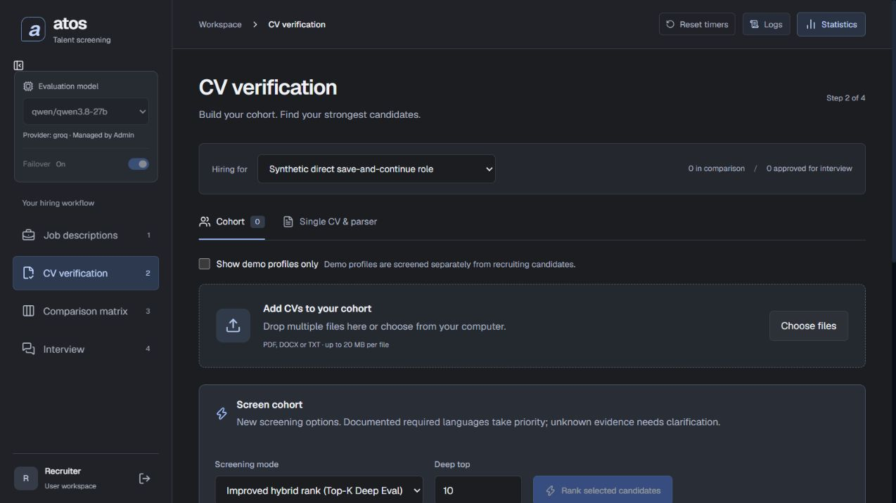

# JD import and screening follow-up

19 October 2026. Fixes applied on top of the existing working tree. Recruitment data and saved evaluations were not rewritten.

## Job-description actions

Imported weights such as 0.7 and 0.33 were valid for the API but invalid for the editor's HTML step of 0.5. A collapsed criterion could block native form submission without usable feedback. An unfinished import URL could also invalidate an otherwise valid pasted JD.

The editor now accepts decimal weights without rounding and validates the job data explicitly. Invalid fields have a focused, visible error summary with links that open the relevant criterion. Import-only URL input does not block saving a pasted job. Continue saves a new/edited draft before navigating; a saved role continues directly. At least one active criterion is required before continuing to screening.

Browser checks used a synthetic parser and a separate database. Verified: import with fractional weights and unfinished URL -> Save -> persisted role -> Continue to CVs; and a second import -> Save and continue directly -> the newly saved role's CV workspace. Empty drafts show validation errors instead of silent buttons. Original production data and model APIs were not used for these checks.

## English source evidence

Europass PDF text can put Mother tongue(s), language names, and proficiency columns far apart. Source matching previously required an adjacent language/level pair even where the job specified no minimum level. It also missed a source row such as English German under LANGUAGE SKILLS.

For an unspecified minimum, a source-backed language-list entry now establishes language presence. It does not certify Native/C1 proficiency. Explicit CEFR requirements still need corresponding source-backed proficiency. Unrelated academic mentions such as English literature are not enough.

Read-only replay of run 4e111177-fa59-4eba-bb5d-a4c5aad684ac resolves all four false English clarification results; the other six remain met. Ann Other's score changes from 71.5 to 79.0 in this deterministic replay. Scores for some other candidates also improve through the same fix to German source-list evidence. This was not a fresh LLM run and no stored result was replaced.

## Ticket management

Retrieval now recognizes service-tool variants and workflows, including Service Now, Service-Now, Freshdesk, Freshservice, BMC Remedy, OTRS, service requests and support cases. Relevant original text reaches the model even if it omits the exact word ticket. Source passages are bounded to avoid sending large unrelated sections. Mathematical queueing theory remains excluded. Tool names alone do not automatically establish SLA compliance or operational ticketing experience.

The supplied interpretation overstates the saved failure: the actual run contains seven ticket clarifications, one met, one not_met and one partial. One candidate already had verified Jira ticket-triage quotations with a partial result because SLA evidence was missing. Missing evidence must remain unknown; it should not be upgraded just to produce an advance recommendation.

## Latency and provider retries

The run's deep-evaluation stage was 63.89 seconds for all ten candidates (67.71 seconds for the complete run), not roughly ten minutes. The first candidate's 64.45-second usage latency was the sum of four overlapping calls; their captured model-call window was about 16.81 seconds.

Composite usage now reports elapsed time separately from summed model-call work and includes contributing call count/model identifiers. Evaluation audit duration measures elapsed time, including indexing. Deterministic-only evaluations do not inherit another request's last usage.

Removed duplicate API-key rotation inside dynamically managed Groq clients. The dynamic fallback chain owns key rotation once and skips targets that are in cooldown, including frozen runs. Standalone Groq clients retain their own key failover. Requirement prompts request concise reasoning and at most two relevant quotations. No provider-speed improvement is claimed without a fresh measured run.

## Why borderline can remain

Recommendation thresholds are unchanged. The saved run has nine shift-availability clarifications and one partial result. Any unresolved clarification keeps the automated result borderline under the existing policy, even at a good numeric score. Review now names the criteria needing confirmation and explains that the recruiter's saved decision controls progression. The deterministic language replay consequently produces ten borderline results rather than manufacturing advances.

## Verification

- Full backend regression suite: **273 passed**.
- Frontend validation tests: four passed.
- TypeScript and production frontend build passed.
- Browser import/save/continue and visible validation checks passed using isolated synthetic data.
- Temporary preview servers were stopped; the final production build uses the normal backend configuration.
- Existing results remain historical. Refresh the UI and start a new screening to obtain results under these fixes.

