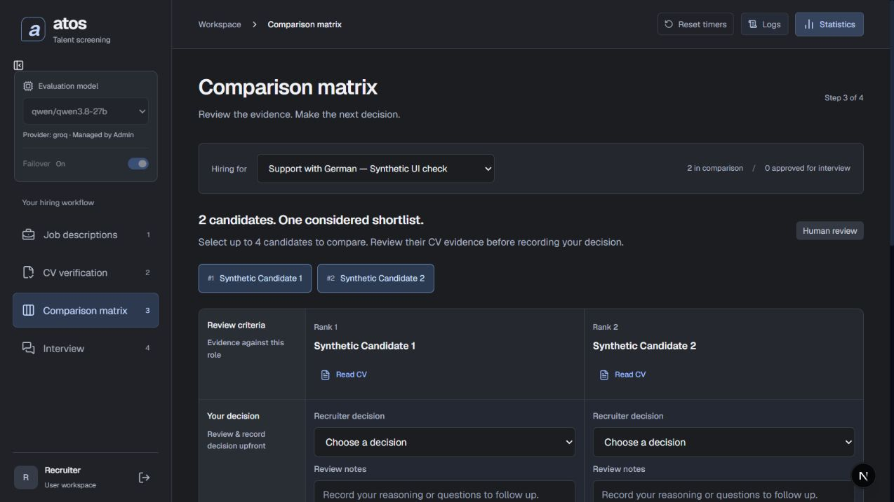

# Screening engine and recruiter workflow fixes

19 October 2026. Implemented on top of the existing uncommitted remediation work. Existing recruitment records and historical evaluations were preserved. No commit was created.

## Corrected behavior

| Area | Result |
| --- | --- |
| Mandatory language selection | Both ranking modes prioritize documented required languages. Unknown or contradicted language evidence stays visible but does not fill the automatic Top-K deep-evaluation budget. Recruiters can explicitly evaluate selected ranked profiles. |
| Language levels | Shared CEFR policy recognizes higher levels and does not invent a minimum when the job specifies none. Deterministic positive deep findings require a quotation from the source. |
| Citations | Backend verification and UI highlighting match contiguous normalized tokens and retain original source spans. Missing positive citations cannot bypass verification. Parsed/generated headings are not accepted as original CV evidence. |
| Retrieval | Storage failures surface as unavailable evaluations. Peripheral/custom sections are excluded from screening retrieval; irrelevant mathematical queues are not ticket-management evidence. Semantic passages must map back to source text. |
| Benchmarks | Demo profiles are separated from recruiting profiles in the UI and API. Seeded profiles carry dataset metadata, tier labels are removed from model inputs, and evidence caches are versioned and fingerprinted. |
| Trace export | Handles requirement_matches, scopes captured calls to job/run, persists calls at candidate checkpoints, and distinguishes reconstructed summaries from captured output. Unknown historical timestamps remain unknown. Empty scoped traces do not include unrelated candidates. |
| Concurrency | Requirement metadata, raw responses, per-call usage and composite token totals are isolated across concurrent calls. Frozen run failover does not change shared model settings. |
| Access | Protected API routes enforce authentication; administrative settings require an admin role. Recruiter model controls show that configuration is managed by Admin. The built-in demo password does not grant admin access. Session signing no longer defaults to a public constant. |
| Approval | A reviewed rejection/hold is not approval to generate an interview. |
| Scoring | Jobs with no active requirements are rejected; unusable low-score results cannot fall through to strong_match. |
| Identity | Matching names alone do not collapse distinct applicants. Document/contact identity is used instead. |
| Historical results | Reads preserve saved verdicts rather than silently rewriting statuses and recommendations. Older runs display a warning and must be restarted under the corrected policy. |
| Job/run navigation | Mismatched job/run requests fail explicitly. Background completion cannot switch the currently selected job. Recovery loads the latest run for the selected role. |
| Review flow | The comparison action is visible outside advanced settings. Completed candidates remain reviewable after partial evaluation failures. Explicit candidate IDs are supported by the shortlist endpoint. |
| Screening controls | Main and quick screening actions share validation and pending state. New settings are distinguished from displayed run configuration. |
| Evidence navigation | Clicking a citation opens and highlights the source after profile loading. A missing source passage has an explicit message. |
| Interview/review state | Run cache keys are consistent. Interview plans refresh from run state; saved review updates refresh untouched fields while preserving local drafts. |

## Verification

- Full Python suite: **255 passed** against an isolated scratch database with cached embedding models.
- Affected retrieval/agent regressions: **26 passed** after the final retrieval cleanup.
- Final trace/workflow regression pass: **65 passed** after the final export corrections.
- Production Next.js build passed, including TypeScript checking and static page generation.
- Browser verification used synthetic candidates and a separate database: invalid Top-K disabled both buttons; a partial run reached comparison; mismatched job/run navigation showed recovery; citation navigation highlighted the source after loading.
- Temporary preview servers were stopped after verification.

## Operational notes and remaining work

Start a fresh screening to apply corrected rankings and evidence checks. Historical runs, original CVs, and saved decisions were not rewritten. Existing affected vector entries are rebuilt lazily when candidates are indexed again.

No live provider screening was used to claim ranking accuracy. The passing tests establish the reproduced policy and workflow fixes; real-model retrieval/ranking quality still requires a labeled benchmark and human review. Evidence filtering deliberately returns clarification when support is insufficient.

Before shared deployment, configure private administrator/recruiter credentials and a stable AUTH_SECRET_KEY. Without an explicit signing key, the generated development key invalidates sessions when the backend restarts and does not support independent workers sharing sessions.

Candidate listing still downloads a bounded library and filters/pages it in the browser. Replacing that with server-side search/pagination and cohort-wide selection is a remaining performance task, not completed in this patch. Complete historical raw-call coverage cannot be recovered from old runs; exports identify that limitation. Original CVs and parsed profiles remain available even where peripheral information is excluded from screening retrieval.

No source files were deleted without evidence that they were unused. Safe cleanup here removed redundant peripheral indexing and retroactive read-time verdict rewriting. Broader module/file consolidation should be a separate change so it does not obscure the engine corrections.
